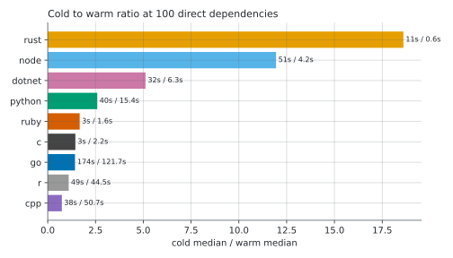
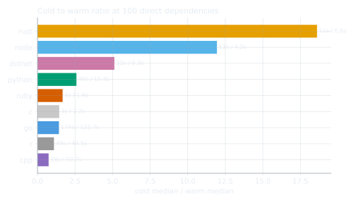
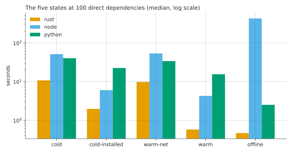
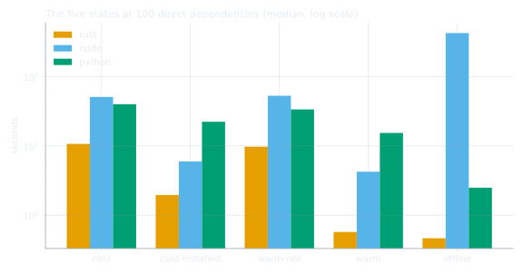
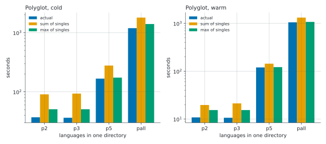
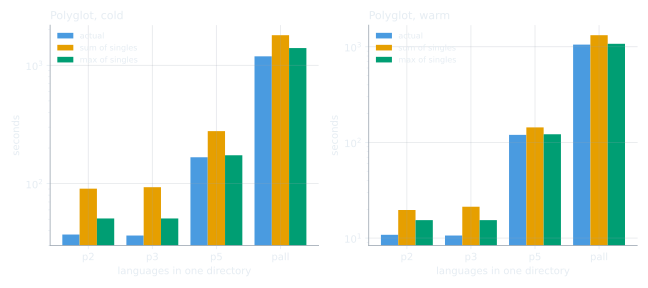
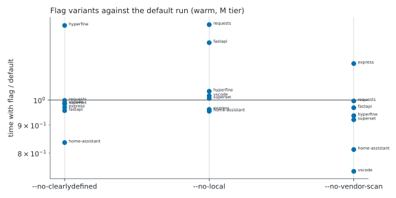

:description: How long a Feluda scan takes, per language and project size, on a first run and on later runs, with the full benchmark results.

.. _performance:

Performance
===========

.. rst-class:: lead

   How long a scan takes, what makes it slow, and what makes the second run fast.

Feluda was timed on 37 open source repositories and a synthetic ladder of projects from 10 to
1,000 direct dependencies, across all ten supported languages, on a first run and on later runs.
This page has the results, the charts, and what they mean for your CI.

.. raw:: html

   

     

       1.1 s
       Repeat scan, 1,421 Rust crates
     

     

       87 MB
       Median peak memory
     

     

       37
       Real repositories timed
     

     

       205
       Measured cells
     

   

----

At a glance
-----------

- **Rust is fast at any size.** Feluda reads ``cargo metadata`` and answers locally: a repeat scan of
  1,421 crates takes 1.1 s, and zed goes from 271 s on a fresh machine to 1.9 s.
- **Every other language pays per dependency.** Node, Python, Go, .NET, R and C++ make about one
  registry call per dependency, at roughly 0.1 to 0.9 s each. Go is the slowest, at about
  0.9 s per dependency on a first run.
- **A second run is faster only where the package manager keeps local state.** Installed
  ``node_modules`` make Node 12 times faster at 100 dependencies and NuGet's package cache makes
  .NET 5 times faster. Python gains 2.6 times and Go 1.4 times, while R (1.1) and
  C++ (0.7) barely change, because Feluda does not cache registry answers yet.
- **Several languages in one repository cost about as much as the slowest one**, not the sum: the
  languages are scanned in parallel.
- **Memory is modest.** The median scan peaks at 87 MB and the largest at 837 MB, so a
  2 GB CI runner is enough.
- **Very large Go repositories are too slow today.** Fresh scans of kubernetes and prometheus did not finish within 20 minutes, and grafana (Node and Go) not within an hour.

----

How it was measured
-------------------

.. list-table::
   :header-rows: 0
   :widths: 25 75

   * - Build
     - Release builds of the development branch after 1.17.0. Every run records its binary's hash.
   * - Machine
     - Apple M1, 8 cores, 16 GB, macOS 15.3.2, on power. A Linux pass is planned.
   * - Timing
     - `hyperfine <https://github.com/sharkdp/hyperfine>`__, median of up to 10 samples per cell
       (fewer for slow cells), with p10 and p90 recorded. Peak memory from ``time -l``. Requests counted
       per host by Feluda's own counter (``FELUDA_REQUEST_STATS``, see :doc:`contributing/testing`).
   * - Isolation
     - Every cell had its own ``HOME`` and its own Cargo, Go, Maven, npm, pnpm, uv, NuGet, Gradle, gem
       and R directories, reset as each scenario requires. Cloned repositories never ran their own
       scripts.
   * - Network
     - A single network connection, through a local IPv4 proxy, since this network drops IPv6.
       With a GitHub token, except in :ref:`performance-unauthenticated`.
   * - Corpus
     - A synthetic ladder of real, popular packages per ecosystem (locked where the ecosystem locks),
       plus 37 real repositories pinned to a commit.
   * - Harness
     - `bench/ <https://github.com/anistark/feluda/tree/main/bench>`__ in the repository: the scripts,
       the pinned corpus and the data behind this page, which is generated from it.
   * - Caps
     - 20 minutes per scan for large real repositories, 60 minutes for everything else. A scan that hit
       the cap is reported as *did not finish*; its repeat runs were skipped.

Feluda's speed depends on two kinds of state, and the scenarios below vary them separately:

.. list-table::
   :header-rows: 1
   :widths: 22 39 39

   * - Scenario
     - Feluda's cache (GitHub license table and ClearlyDefined answers)
     - Package manager state (``node_modules``, Cargo and Go module caches, ...)
   * - ``cold``
     - empty
     - empty
   * - ``cold-installed``
     - empty
     - installed
   * - ``warm-net``
     - filled
     - empty
   * - ``warm``
     - filled
     - installed
   * - ``offline``
     - filled
     - installed, network refused

*Installed* means the dependencies were fetched without running any package code
(``cargo fetch``, ``npm ci --ignore-scripts``, ``go mod download``, ``dotnet restore``).

----

Time against project size
-------------------------

Each line is one language, from 10 direct dependencies up to the largest rung run for it. The x
axis counts distinct packages in the report, so transitive dependencies are included.

.. tab-set::

   .. tab-item:: First run (cold)

      .. figure:: _static/benchmarks/time_vs_deps_cold.svg
         :alt: Log log chart of scan time against dependencies on a first run, one line per language.
         :width: 100%
         :figclass: light-only

      .. figure:: _static/benchmarks/time_vs_deps_cold_dark.svg
         :alt: Log log chart of scan time against dependencies on a first run, one line per language.
         :width: 100%
         :figclass: dark-only

   .. tab-item:: Repeat run (warm)

      .. figure:: _static/benchmarks/time_vs_deps_warm.svg
         :alt: Log log chart of scan time against dependencies on a repeat run, one line per language.
         :width: 100%
         :figclass: light-only

      .. figure:: _static/benchmarks/time_vs_deps_warm_dark.svg
         :alt: Log log chart of scan time against dependencies on a repeat run, one line per language.
         :width: 100%
         :figclass: dark-only

.. list-table:: Cost per dependency at the largest rung, and how time grows
   :header-rows: 1
   :widths: 14 18 18 16 16 18

   * - Language
     - First run, s per dependency
     - Repeat run, s per dependency
     - Growth, first run
     - Growth, repeat run
     - Largest rung run
   * - Rust
     - 0.019
     - 0.001
     - 0.55
     - 0.15
     - 1000 direct, 1421 packages
   * - Node
     - 0.501
     - 0.012
     - 0.95
     - 0.35
     - 1000 direct, 1187 packages
   * - Python
     - 0.163
     - 0.099
     - 0.69
     - 0.63
     - 250 direct, 269 packages
   * - Go
     - 0.923
     - 0.652
     - 0.98
     - 1.10
     - 250 direct, 386 packages
   * - .NET
     - 0.617
     - 0.056
     - 1.25
     - 0.71
     - 250 direct, 250 packages
   * - Ruby
     - 0.020
     - 0.012
     - 0.26
     - 0.42
     - 100 direct, 138 packages
   * - R
     - 0.488
     - 0.445
     - 1.05
     - 1.20
     - 100 direct, 100 packages
   * - C++
     - 0.126
     - 0.170
     - 0.83
     - 1.05
     - 100 direct, 298 packages
   * - C
     - 0.036
     - 0.025
     - 0.25
     - 0.50
     - 100 direct, 86 packages
   * - Java
     - 3.230
     - 2.488
     -
     -
     - 10 direct, 433 packages

*Growth* is the exponent of a power law fit: 1 means time grows in proportion to dependencies, below
1 means fixed costs dominate. Java was only run at 10 direct dependencies (433 resolved), because
Maven Central's search API hangs on about half of its requests; see :ref:`performance-limits`.

.. dropdown:: Synthetic ladder, every cell (median seconds)

   .. list-table::
      :header-rows: 1

      * - Language
        - Direct
        - Packages
        - cold
        - cold-installed
        - warm-net
        - warm
        - offline
        - Notes
      * - Rust
        - 10
        - 19
        - 2.63
        -
        -
        - 0.55
        -
        -
      * - Rust
        - 50
        - 88
        - 5.08
        -
        -
        - 0.58
        -
        -
      * - Rust
        - 100
        - 186
        - 10.7
        - 1.96
        - 9.72
        - 0.58
        - 0.47
        -
      * - Rust
        - 250
        - 357
        - 17.1
        -
        -
        - 0.66
        -
        -
      * - Rust
        - 500
        - 692
        - 16.1
        -
        -
        - 0.77
        -
        -
      * - Rust
        - 1000
        - 1421
        - 27.3
        -
        -
        - 1.15
        -
        -
      * - Node
        - 10
        - 16
        - 10.2
        -
        -
        - 3.16
        -
        -
      * - Node
        - 50
        - 92
        - 30.5
        -
        -
        - 3.88
        -
        -
      * - Node
        - 100
        - 165
        - 50.8
        - 5.98
        - 52.9
        - 4.25
        - 424
        -
      * - Node
        - 250
        - 383
        - 133
        -
        -
        - 6.36
        -
        -
      * - Node
        - 500
        - 677
        - 284
        -
        -
        - 9.50
        -
        -
      * - Node
        - 1000
        - 1187
        - 594
        -
        -
        - 16.9
        -
        -
      * - Python
        - 10
        - 17
        - 7.28
        -
        -
        - 4.69
        -
        -
      * - Python
        - 100
        - 104
        - 39.9
        - 22.3
        - 33.6
        - 15.4
        - 2.50
        -
      * - Python
        - 250
        - 269
        - 43.9
        -
        -
        - 26.6
        -
        -
      * - Go
        - 10
        - 14
        - 13.7
        -
        -
        - 6.71
        -
        -
      * - Go
        - 100
        - 186
        - 174
        -
        -
        - 122
        -
        -
      * - Go
        - 250
        - 386
        - 356
        -
        -
        - 252
        -
        -
      * - .NET
        - 10
        - 27
        - 9.19
        -
        -
        - 2.82
        -
        -
      * - .NET
        - 100
        - 100
        - 32.1
        -
        -
        - 6.27
        -
        - install failed: warm
      * - .NET
        - 250
        - 250
        - 154
        -
        -
        - 14.0
        -
        - install failed: warm
      * - Ruby
        - 10
        - 21
        - 1.67
        -
        -
        - 0.73
        -
        -
      * - Ruby
        - 100
        - 138
        - 2.69
        -
        -
        - 1.61
        -
        -
      * - R
        - 10
        - 10
        - 4.39
        -
        -
        - 2.82
        -
        -
      * - R
        - 100
        - 100
        - 48.8
        -
        -
        - 44.5
        -
        -
      * - C++
        - 10
        - 16
        - 3.36
        -
        -
        - 2.38
        -
        -
      * - C++
        - 100
        - 298
        - 37.5
        -
        -
        - 50.7
        -
        -
      * - C
        - 10
        - 10
        - 1.82
        -
        -
        - 0.73
        -
        -
      * - C
        - 100
        - 86
        - 3.12
        -
        -
        - 2.15
        -
        -
      * - Java
        - 10
        - 433
        - 1399
        -
        -
        - 1075
        -
        -

----

First run and later runs
------------------------

   First run time divided by repeat run time, at 100 direct dependencies.

   First run time divided by repeat run time, at 100 direct dependencies.

The gain on a second run comes almost entirely from the package manager's own state, not from
Feluda's cache. At 100 direct dependencies:

.. list-table:: Median seconds at 100 direct dependencies
   :header-rows: 1
   :widths: 40 20 20 20

   * - Scenario
     - Rust
     - Node
     - Python
   * - ``cold``
     - 10.7
     - 50.8
     - 39.9
   * - ``cold-installed``
     - 1.96
     - 5.98
     - 22.3
   * - ``warm-net``
     - 9.72
     - 52.9
     - 33.6
   * - ``warm``
     - 0.58
     - 4.25
     - 15.4
   * - ``offline``
     - 0.47
     - 424
     - 2.50

- **Feluda's cache** saves a near constant 1.4 s (Rust), 1.7 s (Node) and 6.9 s (Python)
  at this size: the GitHub license table.
- **Installed dependencies** save 9.1 s (Rust), 48.6 s (Node) and 18.2 s (Python),
  because licenses are then read from files on disk instead of fetched.
- **Offline**, Rust scans fully in 0.5 s and Python reports all 104 dependencies in 2.5 s.
  Node with ``node_modules`` installed took 424 s, because ``npm`` retries its registry calls
  before giving up.
- **Python with uv on PATH** resolves through ``uv pip compile``, which reports exactly what uv would
  install (104 dependencies at this size). Without uv, Feluda crawls PyPI instead: 123
  dependencies, 269 requests, and no benefit from a repeat run.

.. tip::

   **For fast CI scans**, install dependencies before running Feluda and cache both the package
   manager's directory and Feluda's cache directory (``~/.cache/feluda`` on Linux) between runs.
   For Python, have ``uv`` on ``PATH``.

----

Projects with several languages
-------------------------------

Synthetic projects combining the 100 dependency projects of two, three, five and all ten languages:

.. list-table:: Median seconds
   :header-rows: 1
   :widths: 30 14 14 21 21

   * - Languages
     - State
     - Actual
     - Sum of each alone
     - Slowest alone
   * - Node, Python
     - cold
     - 37.1
     - 90.6
     - 50.8
   * - Node, Python, Ruby
     - cold
     - 36.4
     - 93.3
     - 50.8
   * - Rust, Node, Go, Python, Ruby
     - cold
     - 167
     - 278
     - 174
   * - All ten
     - cold
     - 1192
     - 1798
     - 1399
   * - Node, Python
     - warm
     - 10.8
     - 19.6
     - 15.4
   * - Node, Python, Ruby
     - warm
     - 10.6
     - 21.2
     - 15.4
   * - Rust, Node, Go, Python, Ruby
     - warm
     - 120
     - 143
     - 122
   * - All ten
     - warm
     - 1054
     - 1322
     - 1075

The actual time is close to the slowest single language and well under the sum, because languages
are analysed in parallel and the one time costs (license table, OSI list, vendored code scan) are
paid once. Real repositories with several languages, first run then repeat run:
discourse (Node + Ruby) 141 s, then 124 s; mastodon (Node + Ruby) 39.2 s, then 36.7 s; sentry (Node + Python) 179 s, then 167 s; tauri (Rust + Node) 93.0 s, then 72.5 s; grafana (Go + Node) did not finish within an hour.

----

Real repositories
-----------------

Median seconds, each repository pinned to one commit. *Rows* is the report size; *first* and
*repeat* are the ``cold`` and ``warm`` scenarios.

.. list-table::
   :header-rows: 1
   :widths: 24 8 9 10 10 9 9 21

   * - Repository
     - Size
     - Rows
     - First run
     - Repeat run
     - Ratio
     - Peak MB
     - Notes
   * - `hyperfine <https://github.com/sharkdp/hyperfine>`__ (Rust + Python)
     - M
     - 150
     - 8.45
     - 3.45
     - 2.4x
     - 113
     -
   * - `ripgrep <https://github.com/BurntSushi/ripgrep>`__ (Rust)
     - S
     - 49
     - 3.93
     - 0.54
     - 7.3x
     - 62
     -
   * - `uv <https://github.com/astral-sh/uv>`__ (Rust + Python)
     - L
     - 618
     - 16.0
     - 0.86
     - 18.5x
     - 337
     -
   * - `zed <https://github.com/zed-industries/zed>`__ (Rust)
     - XL
     - 1523
     - 271
     - 1.93
     - 140.2x
     - 790
     -
   * - `docusaurus <https://github.com/facebook/docusaurus>`__ (Node)
     - XL
     - 2468
     - 180
     - 180
     - 1.0x
     - 311
     - install failed
   * - `excalidraw <https://github.com/excalidraw/excalidraw>`__ (Node)
     - L
     - 960
     - 278
     - 270
     - 1.0x
     - 306
     - install failed
   * - `express <https://github.com/expressjs/express>`__ (Node)
     - M
     - 67
     - 15.4
     - 0.76
     - 20.2x
     - 89
     -
   * - `vscode <https://github.com/microsoft/vscode>`__ (Node)
     - M
     - 209
     - 67.0
     - 11.6
     - 5.8x
     - 180
     -
   * - `fastapi <https://github.com/fastapi/fastapi>`__ (Python)
     - M
     - 207
     - 59.1
     - 39.1
     - 1.5x
     - 31
     -
   * - `home-assistant <https://github.com/home-assistant/core>`__ (Python)
     - M
     - 116
     - 48.0
     - 27.0
     - 1.8x
     - 122
     -
   * - `requests <https://github.com/psf/requests>`__ (Python)
     - M
     - 4
     - 4.43
     - 1.25
     - 3.5x
     - 63
     -
   * - `superset <https://github.com/apache/superset>`__ (Python)
     - M
     - 138
     - 41.3
     - 29.2
     - 1.4x
     - 142
     -
   * - `cobra <https://github.com/spf13/cobra>`__ (Go)
     - S
     - 7
     - 8.60
     - 3.80
     - 2.3x
     - 20
     -
   * - `hugo <https://github.com/gohugoio/hugo>`__ (Go)
     - L
     - 429
     - 384
     - 298
     - 1.3x
     - 26
     -
   * - `kubernetes <https://github.com/kubernetes/kubernetes>`__ (Go)
     - L
     -
     - over 20 min
     - skipped
     -
     - 27
     -
   * - `prometheus <https://github.com/prometheus/prometheus>`__ (Go)
     - L
     -
     - over 20 min
     - skipped
     -
     - 43
     -
   * - `BenchmarkDotNet <https://github.com/dotnet/BenchmarkDotNet>`__ (.NET)
     - XL
     - 184
     - 122
     - 17.1
     - 7.2x
     - 435
     -
   * - `Humanizer <https://github.com/Humanizr/Humanizer>`__ (.NET)
     - S
     - 2
     - 2.36
     - 1.07
     - 2.2x
     - 19
     - install failed
   * - `RestSharp <https://github.com/restsharp/RestSharp>`__ (.NET)
     - XL
     - 351
     - 63.6
     - 25.0
     - 2.5x
     - 269
     -
   * - `eShop <https://github.com/dotnet/eShop>`__ (Node + .NET)
     - S
     - 17
     - 8.26
     - 3.78
     - 2.2x
     - 209
     - install failed
   * - `jekyll <https://github.com/jekyll/jekyll>`__ (Ruby)
     - S
     - 43
     - 2.08
     - 0.92
     - 2.3x
     - 18
     -
   * - `rails <https://github.com/rails/rails>`__ (Node + Ruby)
     - L
     - 802
     - 43.0
     - 45.2
     - 1.0x
     - 124
     - install failed
   * - `rubocop <https://github.com/rubocop/rubocop>`__ (Ruby)
     - S
     - 20
     - 2.30
     - 0.80
     - 2.9x
     - 17
     -
   * - `ggplot2 <https://github.com/tidyverse/ggplot2>`__ (R)
     - S
     - 39
     - 11.6
     - 9.10
     - 1.3x
     - 60
     -
   * - `r-manuals <https://github.com/rstudio/r-manuals>`__ (R)
     - S
     - 19
     - 5.64
     - 4.50
     - 1.3x
     - 58
     -
   * - `OpenCL-SDK <https://github.com/KhronosGroup/OpenCL-SDK>`__ (C++)
     - S
     - 10
     - 2.95
     - 1.61
     - 1.8x
     - 14
     -
   * - `mapnik <https://github.com/mapnik/mapnik>`__ (C++)
     - L
     - 900
     - 18.6
     - 17.1
     - 1.1x
     - 16
     -
   * - `curl <https://github.com/curl/curl>`__ (C + C++)
     - M
     - 55
     - 2.11
     - 0.99
     - 2.1x
     - 18
     -
   * - `mybatis-3 <https://github.com/mybatis/mybatis-3>`__ (Java)
     - S
     - 14
     - 161
     - 213
     - 0.8x
     - 18
     - Maven Central hangs
   * - `discourse <https://github.com/discourse/discourse>`__ (Node + Ruby)
     - XL
     - 1974
     - 141
     - 124
     - 1.1x
     - 306
     - install failed
   * - `grafana <https://github.com/grafana/grafana>`__ (Node + Go)
     - XL
     -
     - over 60 min
     - over 60 min
     -
     - 647
     -
   * - `mastodon <https://github.com/mastodon/mastodon>`__ (Node + Ruby)
     - L
     - 498
     - 39.2
     - 36.7
     - 1.1x
     - 103
     - install failed
   * - `sentry <https://github.com/getsentry/sentry>`__ (Node + Python)
     - M
     - 2035
     - 179
     - 167
     - 1.1x
     - 174
     - install failed
   * - `tauri <https://github.com/tauri-apps/tauri>`__ (Rust + Node)
     - L
     - 2100
     - 93.0
     - 72.5
     - 1.3x
     - 519
     - install failed

Notes on the table:

- *install failed* means the package manager could not install that repository's dependencies on
  this machine (a newer pnpm lockfile, a pinned yarn, an older Node engine, a missing .NET workload),
  so its repeat run only had Feluda's own cache warm.
- Java numbers are dominated by Maven Central's search API, which hangs on about half of its
  requests until Feluda's 30 s timeout, so only one Java repository was timed.

----

Flags
-----

Repeat runs on Rust, Node and Python repositories with each opt out flag, against the default scan:

.. list-table:: Median seconds, repeat run
   :header-rows: 1
   :widths: 25 30 15 15 15

   * - Repository
     - Flag
     - With flag
     - Default
     - Ratio
   * - express
     - ``--no-clearlydefined``
     - 0.74
     - 0.76
     - 0.97
   * - express
     - ``--no-local``
     - 0.73
     - 0.76
     - 0.96
   * - express
     - ``--no-vendor-scan``
     - 0.88
     - 0.76
     - 1.17
   * - vscode
     - ``--no-clearlydefined``
     - 11.4
     - 11.6
     - 0.99
   * - vscode
     - ``--no-local``
     - 11.8
     - 11.6
     - 1.02
   * - vscode
     - ``--no-vendor-scan``
     - 8.59
     - 11.6
     - 0.74
   * - fastapi
     - ``--no-clearlydefined``
     - 37.4
     - 39.1
     - 0.96
   * - fastapi
     - ``--no-local``
     - 49.8
     - 39.1
     - 1.27
   * - fastapi
     - ``--no-vendor-scan``
     - 37.9
     - 39.1
     - 0.97
   * - home-assistant
     - ``--no-clearlydefined``
     - 22.5
     - 27.0
     - 0.84
   * - home-assistant
     - ``--no-local``
     - 25.7
     - 27.0
     - 0.95
   * - home-assistant
     - ``--no-vendor-scan``
     - 21.9
     - 27.0
     - 0.81
   * - requests
     - ``--no-clearlydefined``
     - 1.25
     - 1.25
     - 1.00
   * - requests
     - ``--no-local``
     - 1.72
     - 1.25
     - 1.37
   * - requests
     - ``--no-vendor-scan``
     - 1.25
     - 1.25
     - 1.00
   * - superset
     - ``--no-clearlydefined``
     - 28.8
     - 29.2
     - 0.98
   * - superset
     - ``--no-local``
     - 29.4
     - 29.2
     - 1.01
   * - superset
     - ``--no-vendor-scan``
     - 26.9
     - 29.2
     - 0.92
   * - hyperfine
     - ``--no-clearlydefined``
     - 4.71
     - 3.45
     - 1.37
   * - hyperfine
     - ``--no-local``
     - 3.58
     - 3.45
     - 1.04
   * - hyperfine
     - ``--no-vendor-scan``
     - 3.23
     - 3.45
     - 0.94

None of these is a reliable speed win: differences of up to 37 percent are within the noise
of a network bound scan. ``--no-vendor-scan`` is the only one that helps consistently on a large tree
(vscode 12 s to 8.6 s), since it skips the walk for vendored code. Use the flags for what they
change in the report, not for speed.

----

Memory and CPU
--------------

Peak resident memory of the recorded run of each cell: median 87 MB, largest 837 MB. Largest per language: Rust 790 MB (zed), Node 311 MB (docusaurus), Python 740 MB (synthetic, 100 direct), Go 43 MB (prometheus), .NET 435 MB (BenchmarkDotNet), Ruby 124 MB (rails), R 63 MB (ggplot2), C++ 16 MB (mapnik), C 18 MB (curl), Java 28 MB (synthetic, 10 direct), several languages 837 MB (grafana). CPU time is small next to wall time for every language that waits on the network (Go at 100
dependencies: 3.5 s of CPU in 122 s), except Node, which starts one ``npm view`` process per
package (78 s of CPU in 17 s at 1,000 direct dependencies).

.. _performance-unauthenticated:

Without a GitHub token
----------------------

Three rounds an hour apart, on express (Node), requests (Python) and hyperfine (Rust), with no token.
A first run spends 14 GitHub requests on the license table (28 when two analyzers run), so the
unauthenticated limit of 60 requests an hour allows about four first runs an hour from one address.
No request was refused. A later run with a filled cache spends none. Set ``GITHUB_TOKEN`` on shared
CI runners, where many jobs share one address.

----

Compared with other tools
-------------------------

The same repositories were scanned with other tools. They do different jobs, so this is context,
not a leaderboard: speed mostly reflects whether a tool looks licenses up at all.

.. list-table::
   :header-rows: 1
   :widths: 16 12 12 14 46

   * - Tool
     - Repositories
     - Tool, median s
     - Feluda, same repositories, median s
     - What it does differently
   * - syft
     - 37
     - 1.34
     - 39.2 (first run)
     - Catalogues packages from lockfiles and installed files without the network; it does not look licenses up, so 51 of 759 sampled packages carried one.
   * - trivy
     - 35
     - 2.55
     - 39.2 (first run)
     - Reports licenses found in files and installed metadata, not lockfile packages. Exited with an error on netty and spring-petclinic when Maven Central rate limited this address.
   * - cdxgen
     - 14
     - 3.58
     - 8.26 (first run)
     - Run with ``--no-install-deps`` so it reads manifests like Feluda does. Fetches licenses from registries, one package at a time (200 s on hyperfine).
   * - scancode
     - 10
     - 34.0
     - 5.64 (first run)
     - Scans every file's content for license text, so it answers which licenses appear in the tree, not which ones dependencies declare. Up to 1.4 GB of memory.
   * - cargo-deny
     - 3
     - 0.17
     - 0.86 (repeat run)
     - Reads installed Cargo metadata. Rust only, needs ``cargo fetch`` first.
   * - license-checker
     - 3
     - 0.35
     - 4.25 (repeat run)
     - Reads installed ``node_modules``. Node only, needs an install first.
   * - pip-licenses
     - 2
     - 0.66
     - 15.4 (repeat run)
     - Reads an installed Python environment. Python only, needs an install first.
   * - go-licenses
     - 0
     -
     -
     - Did not run: it fails on Go 1.27 ("Package math does not have module info").

Where a tool reported a license for a package, it agreed with Feluda in nearly every case once both
were written as SPDX ids (trivy 92 of 93, cargo-deny 266 of 266, license-checker 294 of 300, pip-licenses 125 of 130, cdxgen every package it named). The remaining differences come from three
places: the installed version against the version in the manifest (``minipass``, ``fast-uri``), a
license file against registry metadata (``rison``, ``ieee754``), and free text license names.
OWASP dep-scan (needs a 42 GB vulnerability database) and LicenseFinder (runs ``bundle install``,
which builds native gem extensions) were not run.

----

.. _performance-limits:

Known limits
------------

What the study found Feluda does slowly today, in order of how much it costs:

#. **Registry answers are not cached.** A repeat run asks the registry again for every dependency it
   cannot read from disk, so a repeat run of Go, Python, R or C++ is at most 2.6 times faster
   (.NET does better only because NuGet's own cache skips the restore). Go at 250 dependencies
   sends 298 requests on a repeat run.
#. **Go, Python, .NET, R, C and C++ look dependencies up one at a time.** Rust, Node, Java and Ruby
   run in parallel. This is why Go costs about 0.9 s per module, and why kubernetes and prometheus exceed 20 minutes.
#. **Node starts one** ``npm view`` **process per package** it cannot read from ``node_modules``,
   including platform specific optional packages, at about 0.35 to 0.5 s each on a first run.
#. **No connect timeout.** A registry address that never answers costs the full 30 s request
   timeout, and Maven Central's search API does this for about half of its requests.
   ``dotnet list package`` has no timeout at all.
#. **What is reported depends on what is installed.** express reports 67 dependencies without
   ``node_modules`` and 330 with it; a Python project reports what uv resolves when uv is on
   ``PATH``. Scan the same way in CI and locally to compare reports.
#. **License text is kept as the registry wrote it** for many Maven, CRAN, PyPI and NuGet packages
   (for example "Apache License, Version 2.0" or "MIT + file LICENSE"), rather than as an SPDX id.
   SBOM output maps most of these.
